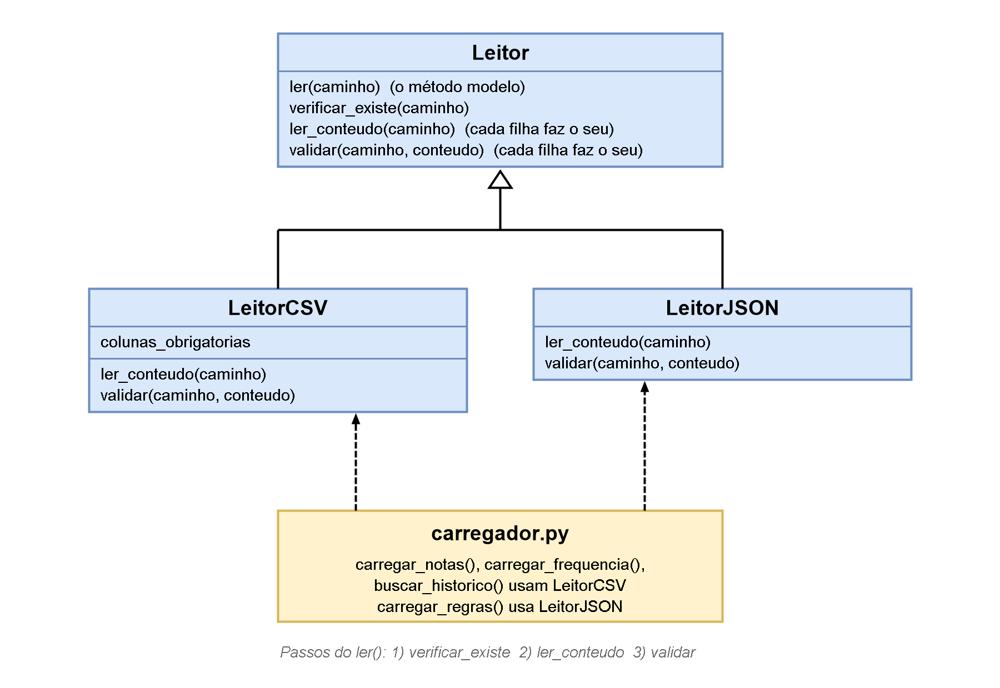
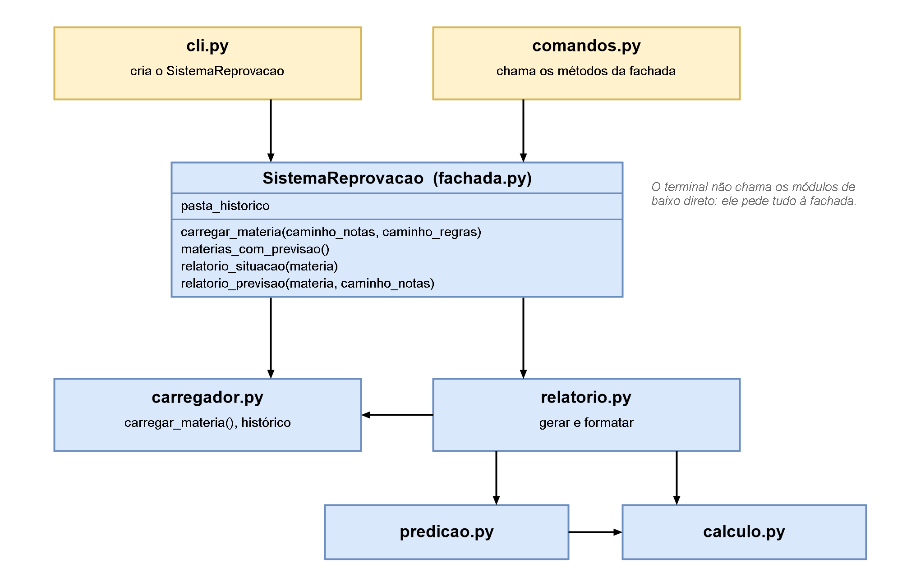
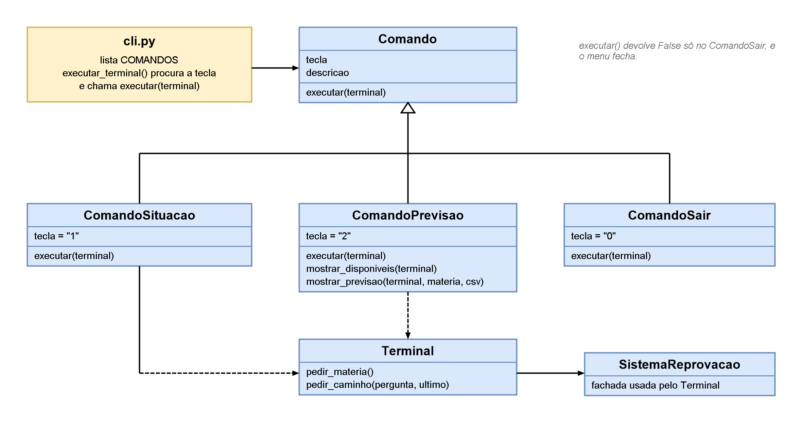

# Refatoração e padrões de projeto (Sprint 4)

Nesta sprint o comportamento do sistema não mudou: a ideia foi reorganizar o código. Os 80 testes que já existiam continuam passando sem nenhuma alteração neles, e foram criados 23 testes para as classes novas (103 no total).

## Template Method (`sistema/leitores.py`)

**Problema.** O `carregador.py` tinha duas funções de leitura, uma para CSV e outra para JSON. As duas faziam a mesma sequência (ver se o arquivo existe, abrir, conferir o conteúdo) e a checagem de arquivo inexistente estava repetida.

**Solução.** A classe `Leitor` tem o método `ler()`, que define a ordem dos passos: `verificar_existe`, `ler_conteudo` e `validar`. As classes `LeitorCSV` e `LeitorJSON` só escrevem os dois passos que mudam.

**Por que esse padrão.** A ordem é sempre a mesma e só o miolo muda conforme o formato. Para aceitar um formato novo basta criar outra classe filha, sem mexer nas que já existem.

**Ponto negativo.** Com apenas dois formatos, são mais linhas do que as duas funções antigas.

## Facade (`sistema/fachada.py`)

**Problema.** O terminal precisava conhecer o `carregador`, o `relatorio` e o `predicao`, além da ordem das chamadas (gerar e depois formatar).

**Solução.** A classe `SistemaReprovacao` oferece quatro métodos: carregar a matéria, listar as matérias com previsão, relatório de situação e relatório de previsão. O terminal só fala com ela.

**Por que esse padrão.** Separa a parte da tela da parte que faz o trabalho. Se um dia existir outra interface, ela pode usar a mesma fachada.

**Ponto negativo.** É uma camada a mais, e uma função nova do sistema precisa ganhar um método na fachada.

## Command (`sistema/comandos.py`)

**Problema.** O menu era uma sequência de `if` e `elif`. Para criar uma opção era preciso mudar o texto do menu, o `if` e a mensagem de opção inválida.

**Solução.** Cada opção virou uma classe que herda de `Comando` e tem `tecla`, `descricao` e `executar(terminal)`. O `cli.py` monta o menu a partir da lista `COMANDOS`. A classe `Terminal` guarda o que os comandos precisam: a fachada, a entrada, a saída e os últimos arquivos usados.

**Por que esse padrão.** Uma opção nova é uma classe nova e um item na lista. O menu e a mensagem de erro se ajustam sozinhos.

**Ponto negativo.** Para três opções, o `if` antigo era mais curto de ler.

## Outras refatorações

| Onde | Antes | Depois |
|---|---|---|
| `calculo.py` | `if` para cada faixa de presença | tabela `FAIXAS_PRESENCA` percorrida em um laço |
| `calculo.py` | `classificar_situacao` fazia tudo em uma função | dividida em `_classificar_com_presenca` e `_frequencia_suficiente` |
| `calculo.py` | tolerância `_EPS` repetida em várias comparações | função `_atingiu(valor, minimo)` |
| `predicao.py` | `prever` com filtro, treino e chance juntos | funções `_alunos_para_treino`, `_treinar_modelos`, `_limitar_nota` e `_calcular_chance` |

## Como conferimos

A cada passo da refatoração rodamos `python -m pytest`. Os testes antigos não foram editados, então servem para mostrar que o comportamento se manteve.
